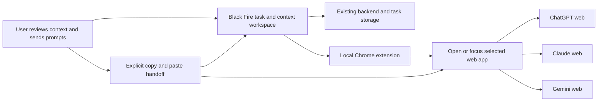
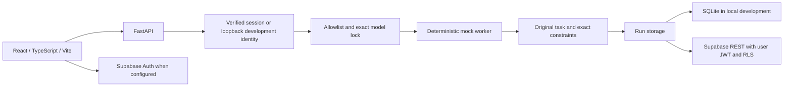

# Black Fire architecture — day one

This document separates the selected browser target from the existing mock implementation. See [the current product direction and workflow](PRODUCT_DIRECTION.md). Provider-API integration work is paused.

## Selected browser target — not implemented yet

The first milestone controls tabs and prepares portable context while the user reviews and transfers the content. It does not require automated reading of chat pages, a hosted browser, or a model-provider API. Per-site automated capture/submission must be evaluated separately. Native desktop control is deferred.

## Existing mock implementation

## Current behavior

A POST requires an Idempotency-Key UUID. The backend hashes the validated request and inserts an accepted record before executing. The database enforces one record per owner/key. Replays retrieve the existing record; changed input with the same key produces 409. A previously accepted record without a final result is not redispatched. This prevents duplicate mock dispatch, but is not a complete interrupted-run recovery system.

Routing accepts only configured, approved routes and exact matching model locks. A request locked to an unavailable model pauses with a reason. There is no live provider or automatic fallback. The mock response is visibly labeled, echoes a bounded preview, and explicitly states that no real task was performed.

The context capsule preserves the original task and requirements without model summarization. It has source-run provenance and a version, but editing/version-conflict handling is future work. Events record step boundaries and are delivered with the saved run; they are not streamed tokens. History returns the newest 30 runs.

## Trust boundaries

- Local SQLite uses a fixed development owner and rejects non-loopback clients, unexpected Host, and untrusted browser Origin values. Production startup rejects SQLite mode.
- Supabase mode verifies the bearer token with the project's Auth `/user` endpoint, then checks issuer, audience, expiry, and subject. No client-supplied owner ID is accepted.
- REST operations forward the verified user's JWT and publishable key. Owner filters and Postgres RLS apply to reads, writes, and deletes. No administrative key is used at runtime.
- The day-one table is owner editable, including its JSON payload. **It is not a trusted usage, quota, audit, or billing ledger.** Before live inference, add a restricted server role and server-owned immutable attempt/usage tables. Public live inference must remain disabled until that gate passes.
- The app renders returned text as React text, not HTML. Uploaded images and remote content execution are absent.
- Secrets and prompts are excluded from ordinary application logs. LangSmith tracing is not configured.

## Deferred coordinator

LangGraph was selected for the earlier API workflow. For the browser-first milestone it is optional and deferred until durable multi-step execution is needed; it is not the browser controller. A tested import attempt on this Windows host failed because application control blocked native `ormsgpack` wheels. A compatible `uuid-utils` wheel resolved a separate import issue, but serializer attempts remained blocked. No system security policy was changed. The working day-one path uses explicit Python route/worker/context steps. LangGraph is not installed by the committed lockfiles and is not claimed as implemented.

## API

| Method | Path | Behavior |
|---|---|---|
| GET | `/health/live` | Process liveness |
| GET | `/health/ready` | Storage readiness and mode; no inference |
| GET | `/api/v1/providers` | Honest capability/configuration registry |
| POST | `/api/v1/runs` | Validate, persist, route, mock, save context/result |
| GET | `/api/v1/runs` | Latest 30 owned runs |
| GET | `/api/v1/runs/{id}` | Owned saved record |
| DELETE | `/api/v1/runs/{id}` | Delete owned run |

## References used

- [FastAPI lifespan/testing](https://fastapi.tiangolo.com/advanced/testing-events/)
- [Vite runtime requirements](https://vite.dev/guide/)
- [Supabase session verification](https://supabase.com/docs/guides/auth/server-side/advanced-guide)
- [Supabase row-level security](https://supabase.com/docs/guides/database/postgres/row-level-security)
- [LangGraph explicit state graphs](https://docs.langchain.com/oss/python/langgraph/use-graph-api)

Earlier research API model names are historical candidates, not verified account access or the active integration target. For the browser milestone, label only the application and model identity that can actually be verified.
